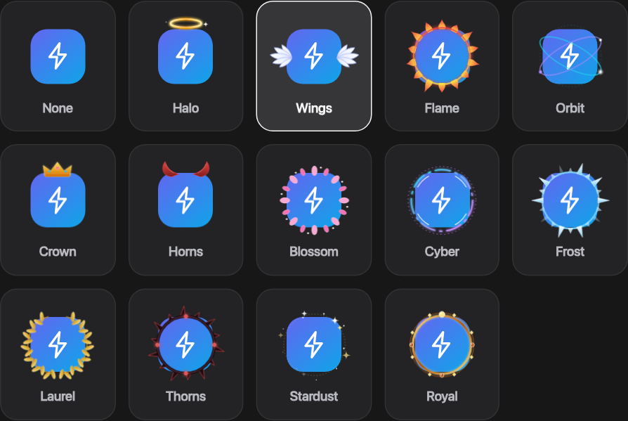
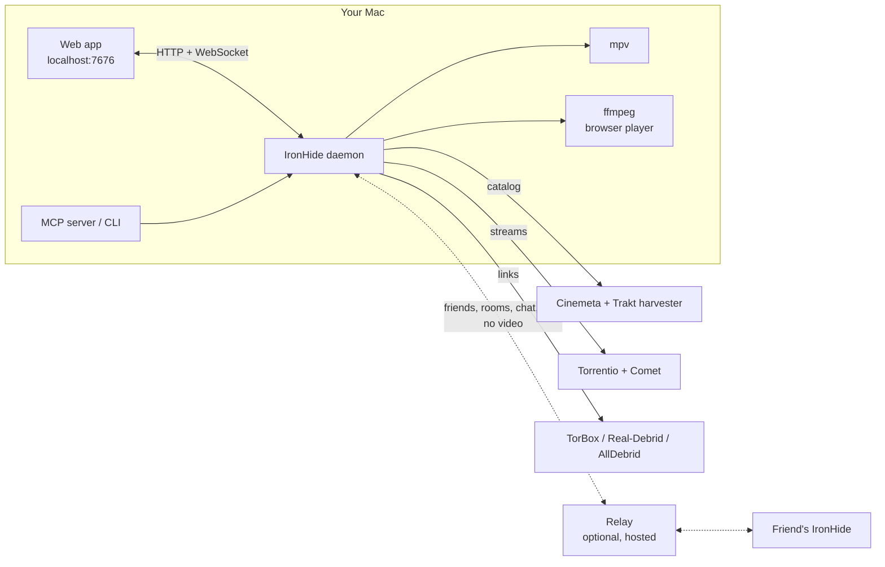

<div align="center">

# IronHide

**A private, members-only media hub for your own Mac.**
Browse, search and stream with one calm interface. Watch together with friends in synced rooms.


<sub>Node 20+ · vanilla ES modules, no build step · TorBox / Real-Debrid / AllDebrid · mpv or in-browser player · optional hosted relay for friends</sub>

</div>

---

## What it is

IronHide is one small service that runs on your own computer. It owns the catalog, the stream lookup, the player and the friends layer, and gives you a fast web app to drive all of it.

- **You browse** curated shelves built from your own Trakt harvester, search anything, and open a title in a centered popup with every available version laid out.
- **You play** in **mpv** (full-screen, GPU, every codec) or in the **browser player** (direct play where possible, GPU transcode where not), with scrub previews, subtitles and audio tracks.
- **You watch together.** Add friends, open a room, pick a title, and everyone's player starts on the same beat and stays in sync, with chat and live reactions on the side.
- **You make it yours** with themes, accents, card sizes, layouts and a full avatar studio with Discord-style decorations.

Nothing is hosted for you. Your keys, history and settings stay on your machine. The only thing you can optionally host is a tiny relay that passes friend, room and chat messages. **No video ever goes through it.**

---

## A tour

### Home
Ambient color follows the title you hover. A hero shows where you left off, tabs switch shelves, and cards stay clean: poster, title, one line of meta.


### Title popup
One centered sheet with the poster, synopsis, cast, trailer, and every version sorted by quality. Pick a recommended version in one click, or filter by 4K / 1080p and sort by size, seeders or name. Tap outside or press `Esc` to close.


### Command palette
Hit search from anywhere. Results come back as a poster strip, with commands (themes, pages) underneath.


### Together
Friends, rooms, chat and reactions in one place. The room lobby shows who is in, who has finished loading (green dot), what is picked, and who controls playback.


### Avatar studio
Upload a photo or build one. Shapes, gradient faces, frames, one-click looks, and **13 big animated decorations** that sit outside the avatar like Discord's. Every decoration is recolorable.




### Settings
Everything saves as you change it. No "Save" buttons except for destructive things.

| | |
|---|---|
| <br><sub><b>Profile</b>: name and avatar studio</sub> | <br><sub><b>Appearance</b>: theme, accent, density, card size, layout, motion</sub> |
| <br><sub><b>Playback</b>: player, preferred quality, HDR, remux, size cap</sub> | <br><sub><b>Connectors</b>: TorBox, Real-Debrid, AllDebrid, TMDB, harvester</sub> |
| <br><sub><b>Nodes</b>: live graph of everything IronHide talks to</sub> | <br><sub><b>Together</b>: relay address, friend code, privacy</sub> |

### On your phone
The rail becomes a bottom bar, the hero stacks, and the shelves scroll sideways.

 &nbsp; 

---

## Features

### Discover
- **Shelves from your own harvester**: For You, Movies, Series, Popular, TV Hits, Most watched, Upcoming, Box office, Continue watching, Shelf. Genre filters and paging.
- **Instant search** across movies and series with poster results and a command palette (`/`).
- **Rich titles**: synopsis, cast, rating, genres, runtime, built-in **trailer player** (loads fast, feels native).
- **Resume & Shelf**: continue from the exact position, keep a watch list, and carry over history from the CLI.

### Pick the right version
- Streams come from **Torrentio** and **Comet**, flagged as *cached* (instant) or *needs a download*.
- One **Recommended** card chosen from your preferences, plus a full list grouped by 4K / 1080p / other.
- Badges for Dolby Vision, HDR10, Atmos, MULTI, Remux, HEVC. Sort by best, size, seeders.
- Preferences: preferred quality, HDR prefer/avoid, remux prefer/avoid, max size, cached-only.

### Play
- **mpv** with IPC: launch indicator, hidden-then-fullscreen hand-off, now-playing companion screen, resume, remote control (pause, seek, volume, tracks, speed).
- **Browser player**: ffprobe plan, direct play when the browser can decode it, GPU transcode (VideoToolbox) when it can't, restart-based seeking, VTT subtitles, audio-track switching, speed, PiP, fullscreen.
- **Scrub previews**: hover for the nearest frame instantly, rest for the exact one.
- Switch between the two in **Settings → Playback**.

### Together
- **Friends** by code, or by name from the **People here** list when your relay runs in directory mode.
- **Rooms** with a 6-letter code, invites, host and "everyone controls" modes.
- **Synced start**: everyone reports when their copy is buffered; play starts on a shared server clock with a countdown.
- **Drift correction**: small drift is eased out with playback-rate nudges, large drift is re-seeked.
- **Chat and reactions** in the lobby and inside the player drawer, with floating emoji.
- **Presence only between mutual friends**, with "Appear offline" and "Hide what I'm watching".
- **Ed25519 identity** generated locally. Your friend code is derived from your public key.

### Make it yours
- **Themes** (Dark, Midnight, Light, System), **accents**, density, corner radius, motion, poster size XS to XL, **grid / detail / list** layouts, hero on or off.
- **Avatars**: photo upload (cropped and compressed in the browser), 7 shapes, custom gradients, 7 frames, 7 one-click looks, **13 decorations** (Halo, Wings, Flame, Orbit, Crown, Horns, Blossom, Cyber, Frost, Laurel, Thorns, Stardust, Royal).
- **First-run name screen** so a new install starts with a name and a face.

### Plays well with Claude
IronHide also ships an **MCP server** and a **CLI**, so you can drive it in plain language from Claude Code: "play Inception", "resume where I left off", "skip forward 5 minutes", "what's playing?".

---

## How it fits together



- **One daemon** (`src/daemon.js`) owns the web UI, the API, the player monitor and the social connection. The MCP server is a thin client that starts it on demand.
- **The web app is plain ES modules**, no bundler. Edit a file, refresh.
- **The relay** (`relay/`) is a ~150 line WebSocket server with everything in memory. It authenticates users by signature, forwards small JSON messages, and never touches media.

---

## Quick start

**You need:** macOS, Node 20+, [mpv](https://mpv.io), ffmpeg, and a debrid account (TorBox recommended).

```bash
git clone <this repo>
cd ironhide
npm install
./setup.sh            # installs mpv + MoltenVK and writes a good mpv.conf
npm start             # or: node src/daemon.js
```

Open **http://localhost:7676**, pick a name, then add your key in **Settings → Connectors**.

### Together with friends

Rooms need a relay that everyone points at.

1. **Deploy the relay** on Render. This repo includes a Blueprint: *New → Blueprint → this repo*. It creates `ironhide-relay` on the free plan with the people list enabled.
2. Copy its URL, change `https://` to `wss://`, and either paste it on the **Together** page or set it once in `src/relay-default.js` so everyone who pulls the repo connects automatically.
3. Each friend runs IronHide on their own Mac with their own debrid key, then adds you from **People here**.

Run a relay locally to try it: `RELAY_DIRECTORY=1 PORT=8790 node relay/server.js`, then point two IronHides at `ws://localhost:8790` (the second one with `IRONHIDE_HOME=/tmp/ih2 IRONHIDE_PORT=7677`).

### Configuration

| Variable | What it does |
|---|---|
| `IRONHIDE_PORT` | Daemon port (default `7676`) |
| `IRONHIDE_HOME` | Config and data folder (default `~/.config/ironhide`). Use a different one per instance |
| `IRONHIDE_RELAY` | Default relay address when none is set |
| `IRONHIDE_NO_BRIDGE` | Skip the optional TV bridge |
| `RELAY_DIRECTORY=1` | (relay) enable the People list and unique online names |
| `PORT` | (relay) port, default `8790` |

Keys live in `~/.config/ironhide/config.json` and are never sent anywhere except to the service they belong to. API errors have keys stripped before they reach the browser.

---

## Project layout

```
src/            daemon, API, catalog, stream lookup, player, webplay, social client
web/            the web app: js/ (pages, player, together, avatar studio), css/
relay/          the optional friends/rooms relay (deploys on its own)
mcp/            MCP server (thin client for the daemon)
bin/            the ironhide CLI
hub/            experimental multi-user host (one private daemon per name)
docs/screens/   screenshots used in this README
```

---

## Status

Working and checked in a browser: browsing, search, title popup, settings, avatar studio, friends, rooms, chat and reactions between two instances.

Still to prove end to end: synced playback across two real players, the browser player's HEVC / 4K / transcode paths, and the mobile layout on a real phone.

`hub/` is an experiment for hosting many users on one server. Playing straight from the debrid CDN in a browser turned out to fail for most releases (DTS and similar audio), so the supported setup is *everyone runs their own IronHide, one shared relay*.

---

## Notes

- IronHide is a player and a lookup tool. It does not host or index content. You are responsible for what you stream and for following the terms of the services you connect and the laws where you live.
- Each person should use **their own** debrid account. Sharing one account between people breaks most providers' terms.

<div align="center"><sub>Built with plain JavaScript, a lot of CSS, and no build step.</sub></div>
