<div align="center">

# IronHide

### Everything worth watching, one click away, picked for you.

A native Mac app and web app that learns your taste, finds any film or series as you type,<br>
picks the best version for you and plays it in 4K, alone or perfectly in sync with friends.

<br>

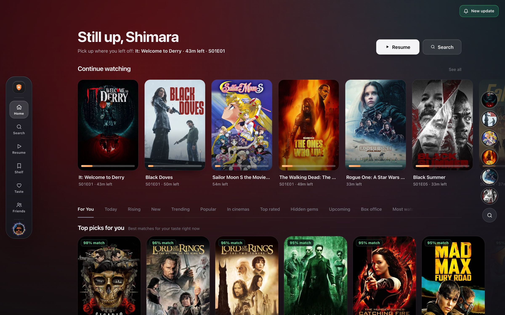

<br>

<sub><b>macOS</b> · Tauri 2 + libmpv · plain JavaScript, no build step · runs entirely on your Mac</sub>

</div>

<br>

<table>
<tr>
<td width="33%" valign="top">

### Picks that know you
Every rating, every film you finish, every series you binge shapes **For You**. Each pick says why: *Because you loved FROM*, with a match score.

</td>
<td width="33%" valign="top">

### One click to the best version
**Play** starts the right release for you instantly: 4K, Dolby Vision, your language, cached. Want to choose? The version picker explains every option.

</td>
<td width="33%" valign="top">

### Feels like a native app
Titles open the instant you click, posters load where you look, video plays in-window with hardware decoding. No lag, no spinners.

</td>
</tr>
</table>

<br>

## A title page with everything you need

Backdrop, scores from IMDb, TMDB and reviewers, your own rating, episodes with thumbnails and progress, cast, reviews and more like this. The line under **Play** tells you exactly what you'll get before you press it.

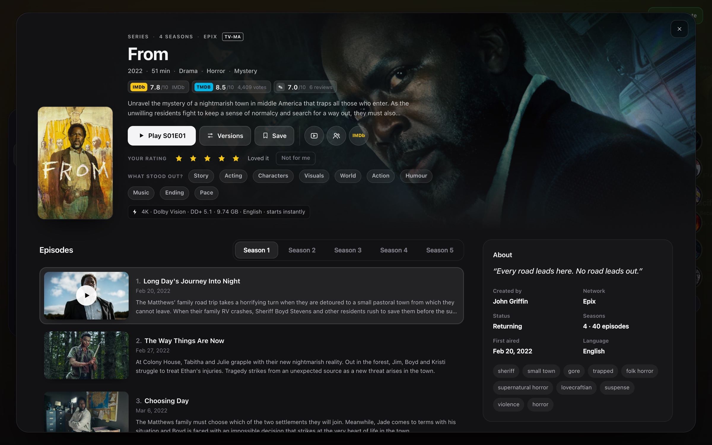

<br>

## Pick a version, not a torrent

Dozens of near-identical releases become one clear table. Duplicates are merged, the **best for you** sits on top with plain reasons, and alternatives are labelled for what they're good at: best picture, best sound, lightest, most shared. Sort by size or seeders; dubs you don't speak are flagged.

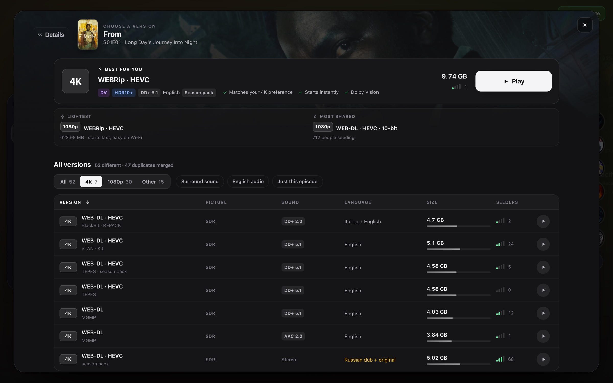

<br>

## Search that understands you

Results on every keystroke, with your recent searches waiting when you open it. Type a title, an actor, or what you're in the mood for.

<table>
<tr>
<td width="62%">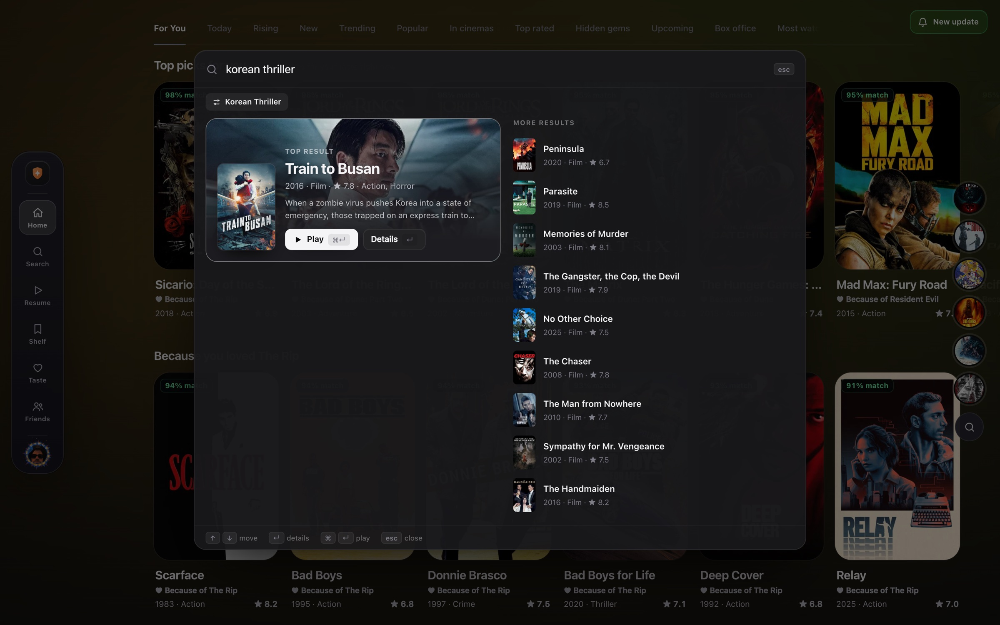</td>
<td width="38%" valign="top">

`korean thriller` → Train to Busan, Parasite, Memories of Murder<br><br>
`sci-fi series 2024` → filtered by genre, year and type<br><br>
`90s horror` → by decade<br><br>
`like interstellar` → titles people who loved it also loved<br><br>
`harold perrineau` → the actor, then everything he's in<br><br>
<kbd>↑</kbd> <kbd>↓</kbd> move · <kbd>↵</kbd> details · <kbd>⌘</kbd><kbd>↵</kbd> play

</td>
</tr>
</table>

<br>

## For You, in rows

**Top picks for you**, **Because you loved…** for your strongest favourites, **Hidden gems** (well liked, less known) and **Something different**: acclaimed titles outside your usual, so your taste can grow.

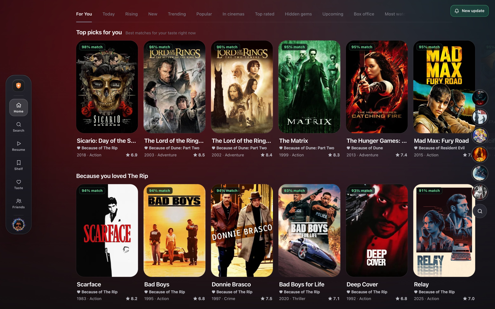

<br>

## What's popular today, what's going viral

Live charts that update through the day: **Today** (ranked), **Rising** (climbing fastest right now), **New** (fresh films, new series and new seasons), **Trending**, **Popular** and **In cinemas**. Films, series or both in one tap.

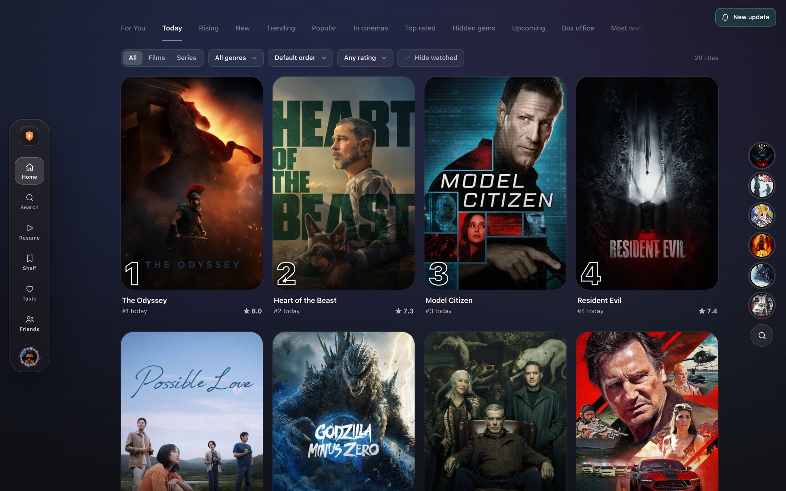

<br>

## Taste Lab

Teach your picks in a minute. **Rate** is a card stack you swipe through (→ liked, ← not for me, ↑ want to watch, ↓ haven't seen). **This or that** asks which of two favourites you enjoyed more and ranks them, chess-style. **Your board** is your all-time top list.

<table>
<tr>
<td width="50%">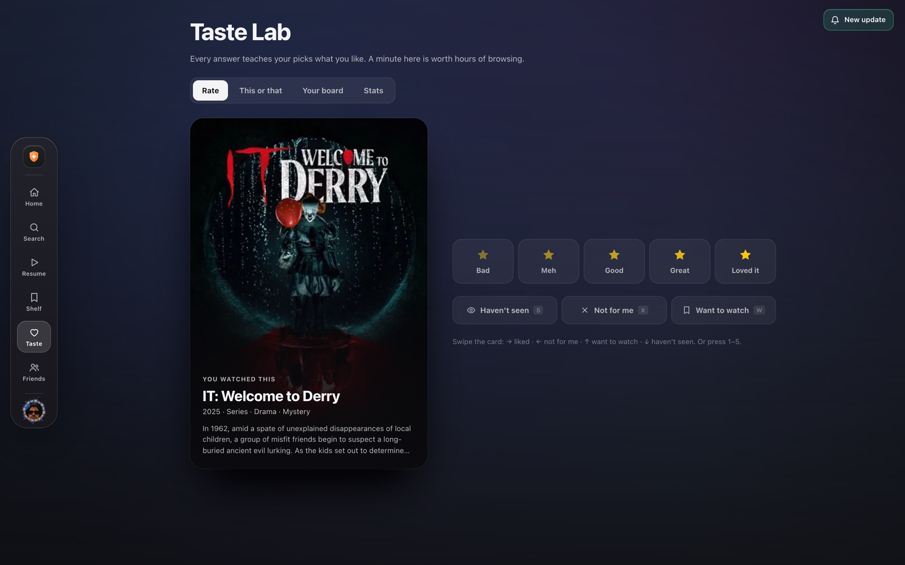<br><sub><b>Rate</b> · starts with what you watched but never rated</sub></td>
<td width="50%">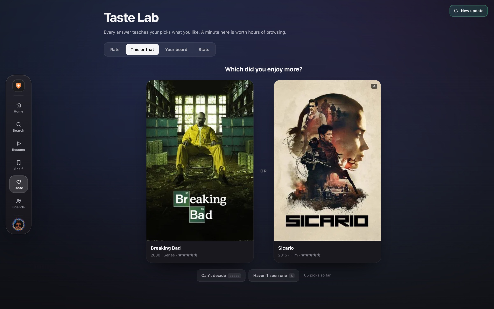<br><sub><b>This or that</b> · close calls teach it the most</sub></td>
</tr>
</table>

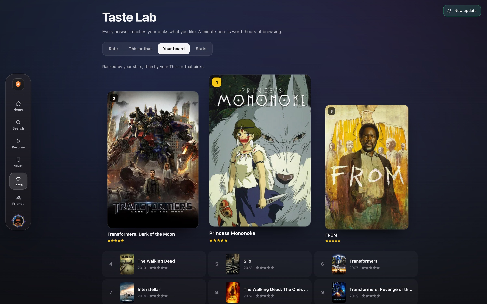

<br>

## People, not just titles

Click anyone in the cast: photo, biography, age and birthplace, career stats, links, **known for**, photos and a full filmography you can open titles from.

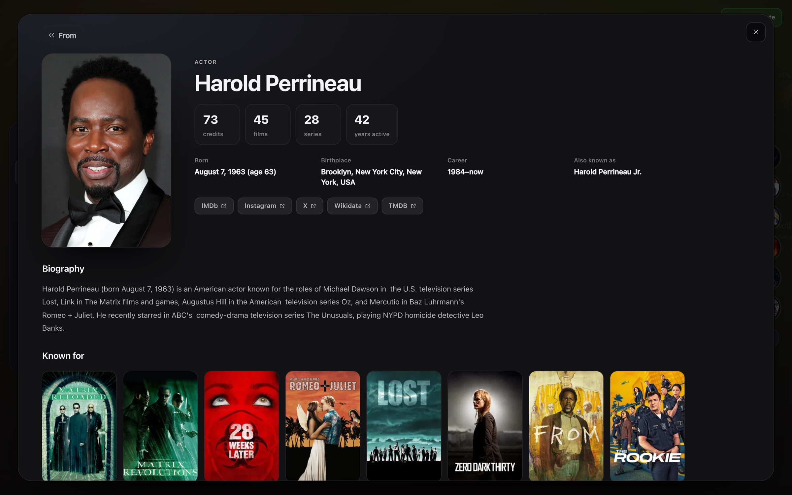

<br>

## From click to picture

A calm "getting ready" screen shows the exact version and each step, then the video plays **inside the app window**: libmpv with VideoToolbox hardware decoding, so 4K HEVC, Dolby Vision and HDR just work.

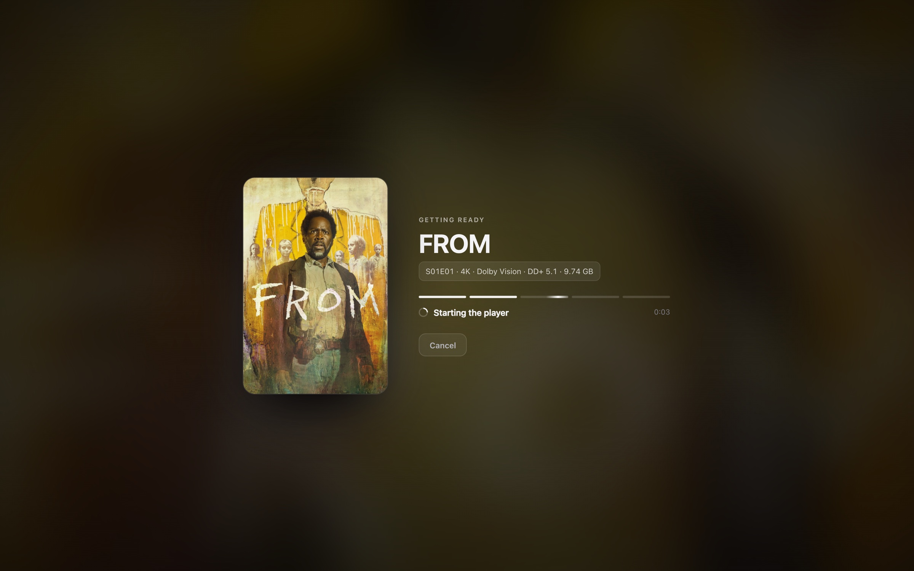

- **Buffers two minutes ahead**, keeps a large back-buffer, seeks inside it instantly and reuses one connection for far jumps.
- **Pause and walk away**: after a few seconds the screen fills with the title, story, cast and a review instead of a frozen frame.
- **Picture looks** grounded in calibration practice: Reference, Film, Dark room, Bright room, Shadow detail, Animation, Restore and Vivid, with one suggested for what's playing.
- **The screen stays awake** while a video plays.

<br>

## How the recommendations work

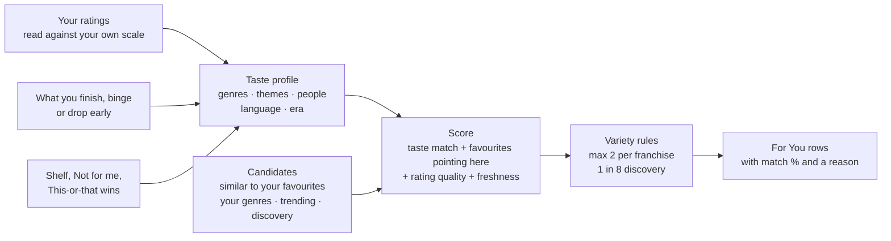

- **Your stars, your scale.** If most of your ratings are 5★, a 3★ means "meh", and it's read that way.
- **Distinctive beats common.** A rare theme you love counts more than "Drama", which is on half of everything. Themes and people only count once they recur across titles you like.
- **Quality floor.** Unreleased titles and obscure, poorly rated filler only get through on a very strong match.
- **It learns from what you skip.** Picks you scroll past sink; ones you open rise. **Not interested** removes a title everywhere and pulls similar ones down.

<br>

## Watch together

Friends, rooms, a shared countdown, drift-corrected sync, chat and live reactions. Everyone runs their own IronHide with their own debrid account; a tiny optional relay passes messages. **No video ever goes through it.**

<table>
<tr>
<td width="50%"></td>
<td width="50%">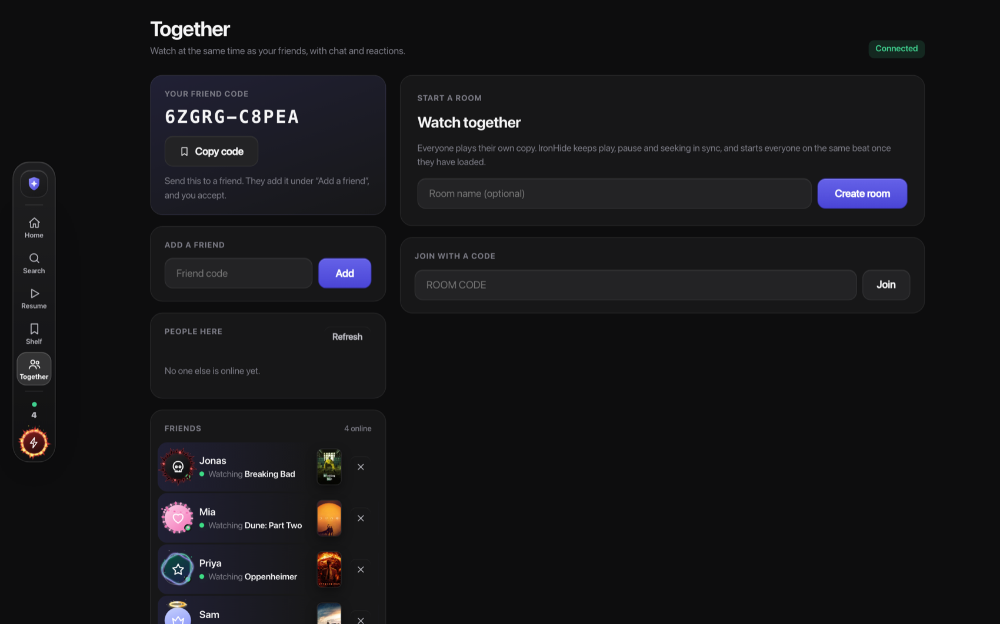</td>
</tr>
</table>

<br>

## Make it yours

Upload a photo or build an avatar: 16 animated decorations, 20 polygon shapes with a faceted bevel, gradients and one-click looks. Themes, density, corner radius and motion live in Settings, and every change saves itself.


<details>
<summary><b>More: settings, avatar studio and phone layout</b></summary>
<br>

<table>
<tr>
<td width="50%"><br><sub><b>Appearance</b> · theme, accent, density, radius, motion, card size</sub></td>
<td width="50%"><br><sub><b>Playback</b> · player, quality, HDR, remux, size cap, audio languages</sub></td>
</tr>
<tr>
<td width="50%"><br><sub><b>Connectors</b> · TorBox, Real-Debrid, AllDebrid, TMDB</sub></td>
<td width="50%"><br><sub><b>Nodes</b> · a live graph of every service, with latency</sub></td>
</tr>
<tr>
<td width="50%"><br><sub><b>Avatar studio</b></sub></td>
<td width="50%"><br><sub><b>Shapes</b> · true polygons, lit like cut gems</sub></td>
</tr>
</table>

 &nbsp; 

</details>

<br>

## Talk to it

An MCP server and a CLI let Claude drive it: *"play Inception"*, *"resume where I left off"*, *"what's playing?"*, *"put it on the TV"*.

<br>

## How it fits together

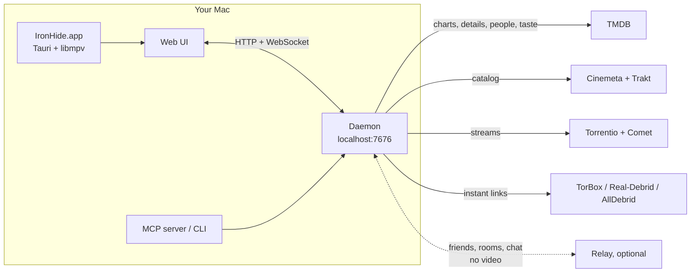

- **One daemon** (`src/daemon.js`) serves the UI and API, runs the player hand-off, recommendations, search and social.
- **The Mac app** (`mac/`) is a small Rust shell: the web UI in a WKWebView, video drawn natively underneath by libmpv.
- **The web app is plain ES modules.** Edit a file, press <kbd>⌘R</kbd>.

<br>

## Quick start

You need macOS 12+, Node 20+, [mpv](https://mpv.io) (`brew install mpv`), ffmpeg, a debrid account (TorBox recommended) and a free [TMDB](https://www.themoviedb.org/settings/api) API key.

```bash
git clone <this repo> && cd ironhide
npm install
./setup.sh                 # mpv + MoltenVK and a tuned mpv.conf
cd mac && cargo tauri dev  # the Mac app (or `npm start` for the web app on :7676)
```

Pick a name, then add your keys in **Settings → Connectors**. To build the app: `cd mac && cargo tauri build --bundles app`.

<details>
<summary><b>Watch with friends: deploy the relay</b></summary>
<br>

1. Render → *New → Blueprint* → this repo. It creates `ironhide-relay` on the free plan.
2. Copy its URL, change `https://` to `wss://`, paste it on the **Friends** page (or set it in `src/relay-default.js`).
3. Each friend runs their own IronHide with their **own** debrid key.

Local test: `RELAY_DIRECTORY=1 PORT=8790 node relay/server.js`, then two IronHides pointed at `ws://localhost:8790` (the second with `IRONHIDE_HOME=/tmp/ih2 IRONHIDE_PORT=7677`).

</details>

<details>
<summary><b>Configuration</b></summary>
<br>

| Variable | What it does |
|---|---|
| `IRONHIDE_PORT` | Daemon port (default `7676`) |
| `IRONHIDE_HOME` | Config and data folder (default `~/.config/ironhide`), one per instance |
| `IRONHIDE_ROOT` | Use this folder's `src/` and `web/` in the Mac app |
| `IRONHIDE_RELAY` | Default relay address |
| `RELAY_DIRECTORY=1` | Relay: enable People here |

Keys live in `~/.config/ironhide/config.json` (`tmdb_api_key`, `torbox_api_key`, optional `omdb_api_key` for Rotten Tomatoes and Metacritic scores) and only go to the service they belong to.

</details>

<details>
<summary><b>Project layout</b></summary>
<br>

```
mac/            the Mac app: Rust (Tauri 2) shell, in-window libmpv player
src/            daemon, API, recommendations, search, charts, streams, player, social
web/            the UI: pages, title sheet, Taste Lab, search, player, CSS
relay/          the optional friends / rooms relay
mcp/            MCP server (a thin client for the daemon)
bin/            the ironhide CLI
docs/screens/   the screenshots above
```

</details>

<br>

## Notes

- IronHide is a player and a lookup tool. It does not host or index content. You are responsible for what you stream and for following the terms of the services you connect and the laws where you live.
- Each person should use **their own** debrid account. Sharing one breaks most providers' terms.

<div align="center"><br><sub>Made with care, plain JavaScript and a lot of CSS.</sub></div>
