<div align="center">

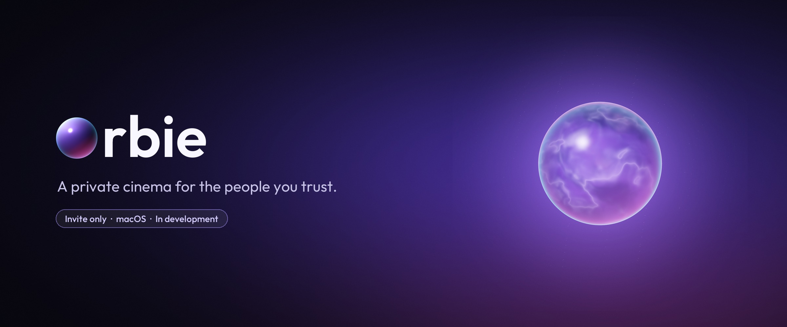

<br>

**Every film and series, one click away. Picked for you, played in 4K, watched together.**

<sub>Invite only&nbsp;&nbsp;·&nbsp;&nbsp;macOS 15+ on Apple Silicon&nbsp;&nbsp;·&nbsp;&nbsp;In active development</sub>

</div>

<br>

> [!NOTE]
> **Orbie is private and invite only.** It isn't on the App Store and the repository isn't public. Access is passed on
> person to person: if someone you trust gave you an invite, welcome. If not, ask them. Things change fast and some
> edges are still rough; that is on purpose, this is where it gets built.

<br>

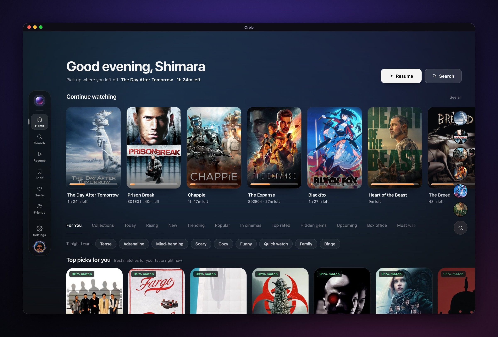

<br>

## What Orbie is

Orbie is a cinema that lives on your Mac. Open it and it already knows what you were watching, what you would love next
and which version of a film will look and sound best on your screen. Press **Play** and it starts, in the app window, in
seconds. No browsing through files, no ads, no rows of things you will never watch.

It learns from you, not from a crowd: your ratings, what you finish, what you drop after ten minutes, what you put on
your shelf. Everything it learns stays on your own Mac.

<table>
<tr>
<td width="33%" valign="top">

### Picks that know you
Every rating and every series you binge shapes **For You**. Each pick says why, with a match score built from your own taste.

</td>
<td width="33%" valign="top">

### The best version, instantly
4K, Dolby Vision, Atmos, your language. Orbie picks the right copy and starts it straight away. Curious? Every option is explained.

</td>
<td width="33%" valign="top">

### Made for the Mac
A native app with real hardware decoding, 120 Hz motion, media keys, Picture in Picture and a menu bar remote.

</td>
</tr>
</table>

<br>

## A closer look

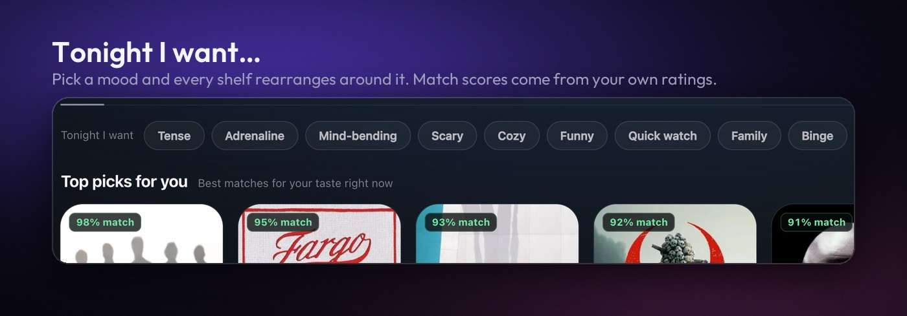

<table>
<tr>
<td width="50%">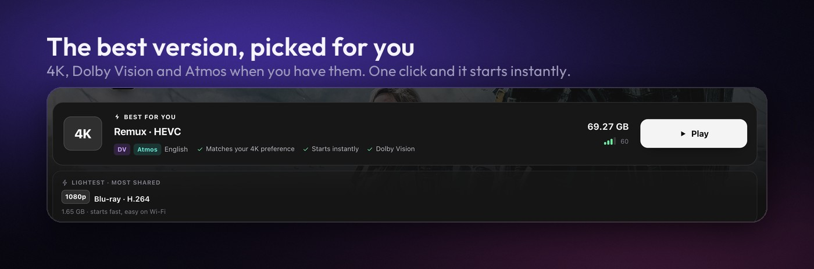</td>
<td width="50%">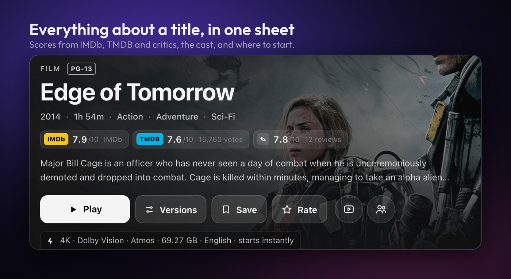</td>
</tr>
<tr>
<td width="50%">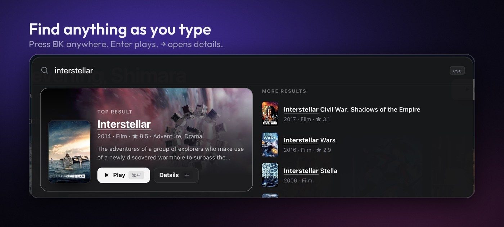</td>
<td width="50%">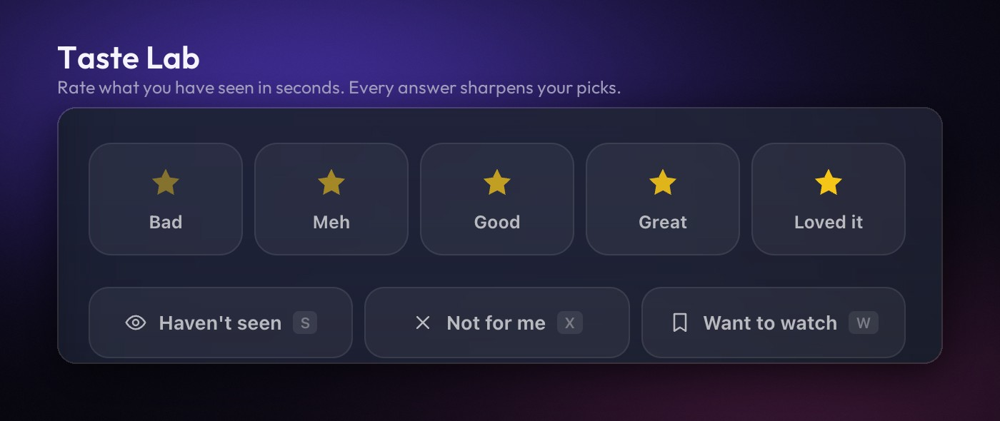</td>
</tr>
</table>

<br>

## Every title, one sheet

Open anything and get the whole picture: scores from IMDb, TMDB and critics, the story, the cast and crew, trailers,
reviews and more like it. For series, every season and episode with what you have already seen ticked off.

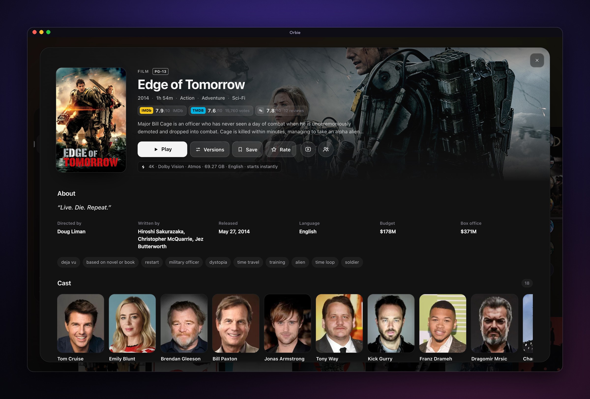

## Choose a version, not a file

Orbie gathers every copy of a film, merges the duplicates and ranks what is left for **you**: picture, sound, language,
size and how fast it starts. The top one is marked *Best for you* and plays with one click. Want something lighter for
Wi-Fi, or a specific language? It's one row down, with every difference spelled out.

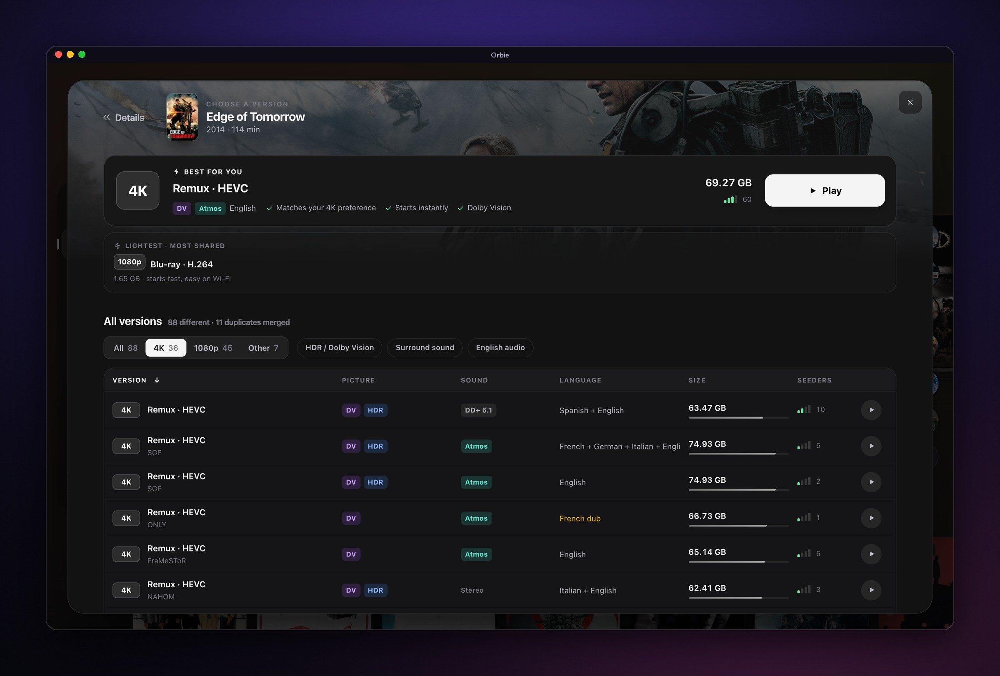

## Shelves for every mood

More than eighty hand-made collections: edge-of-your-seat thrillers, mind-benders, Studio Ghibli, slow-burn crime,
films and series **by country** from Sweden to Lithuania to South Korea, and seasonal shelves that show up when it is
the right time of year.

<table>
<tr>
<td width="50%">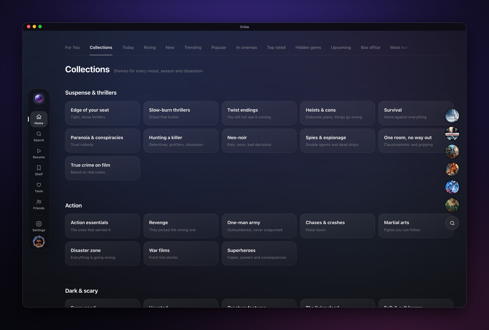</td>
<td width="50%">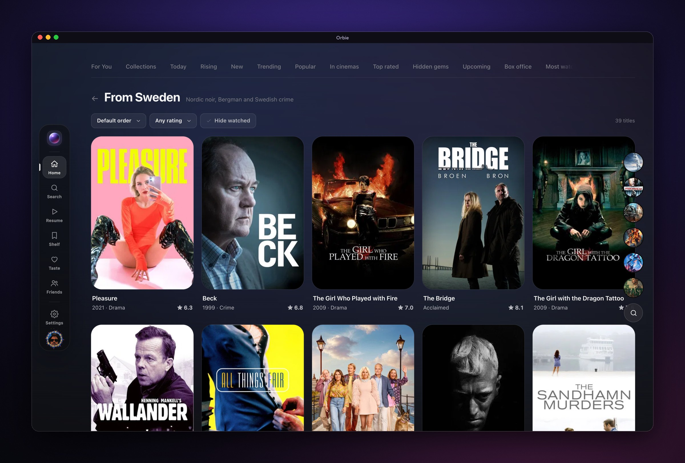</td>
</tr>
</table>

## Find anything as you type

Press <kbd>⌘</kbd> <kbd>K</kbd> anywhere. Results appear while you type, with the best match up top, ready to play.
<kbd>Enter</kbd> plays, <kbd>→</kbd> opens the details.

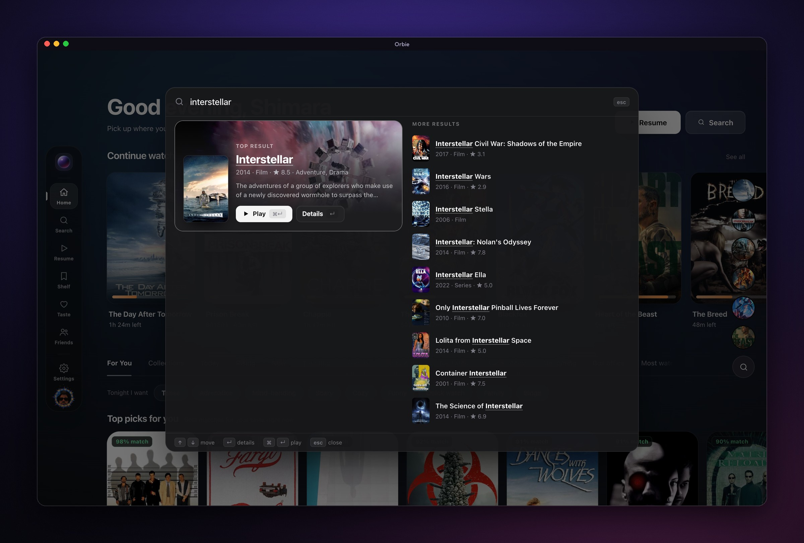

## It gets to know you

**Taste Lab** turns rating into a game: swipe through what you have seen, play *This or that* to rank favourites, and
watch your picks sharpen with every answer. Your **profile** keeps the story of your year in film: hours watched,
streaks, medals and everything you finished.

<table>
<tr>
<td width="50%">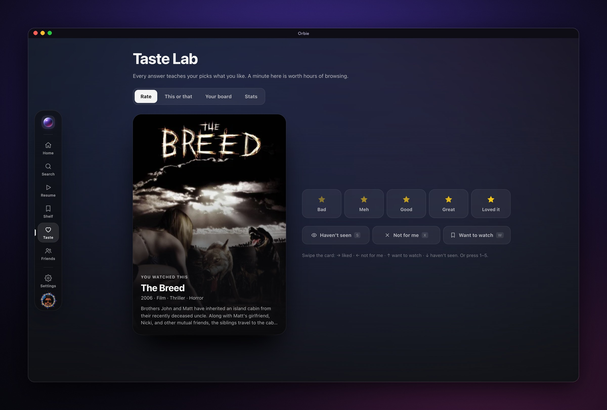</td>
<td width="50%">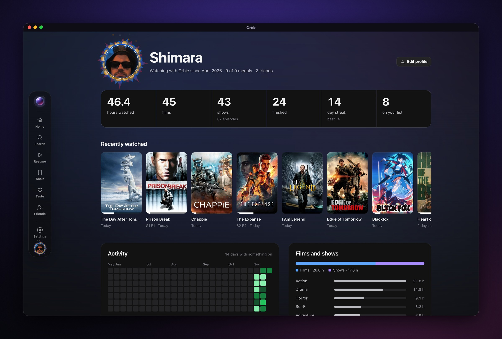</td>
</tr>
</table>

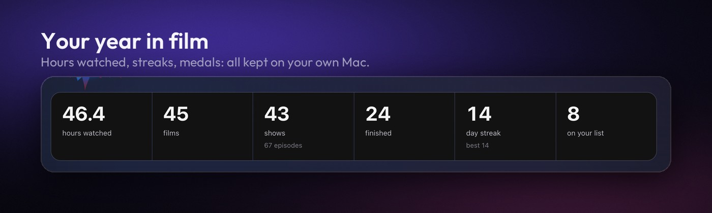

<br>

## Watch together

Invite a friend into a room and press play together. Orbie keeps everyone in sync to a fraction of a second, with a
shared countdown, chat and live reactions. Each person streams on their own Mac with their own account; a tiny relay
only passes messages between you. **No video ever goes through it.**

## And a few more things

- **Picture and sound**: picture looks grounded in calibration practice (Reference, Film, Dark room…), HDR and Dolby Vision tone-mapping, Atmos and surround passthrough.
- **Smooth everywhere**: the interface runs at your display's refresh rate, up to 120 Hz on ProMotion. Press <kbd>⌘</kbd> <kbd>⇧</kbd> <kbd>F</kbd> for a live frame-rate meter.
- **Instant track switching**: change audio or subtitles mid-film without the picture stopping to buffer.
- **On your TV**: send what you're watching to a Samsung TV in one click.
- **Discord**: show *Watching* with the poster, episode and a live progress bar on your profile, like the big apps do. One switch in Settings.
- **New episodes**: a quiet notification when a show you keep up with has a new one.
- **Talk to it**: Orbie comes with an MCP server, so Claude can find, play, pause and recommend for you in plain words.

<br>

## Getting in

Download Orbie from the public page, [**Manteh/orbie-app**](https://github.com/Manteh/orbie-app), or paste this into
Terminal (it installs and opens the app, and running it again updates):

```bash
curl -fsSL https://raw.githubusercontent.com/Manteh/orbie-app/HEAD/install.sh | bash
```

The first screen asks for an invite. Invites are signed by the person who sends them, all the way back to the owner,
and every member can pass on three (Settings → Invites).

Then open **Settings → Connectors** and add:

| | |
|---|---|
| **A debrid account** | TorBox recommended. It's what makes every stream start instantly. Use your **own**; sharing one breaks most providers' terms. |
| **A TMDB key** | Free at [themoviedb.org](https://www.themoviedb.org/settings/api). Powers picks, search, charts and collections. |

Run the same line again any time to update. Orbie also tells you when a new version is ready.

<details>
<summary><b>How it fits together</b></summary>
<br>

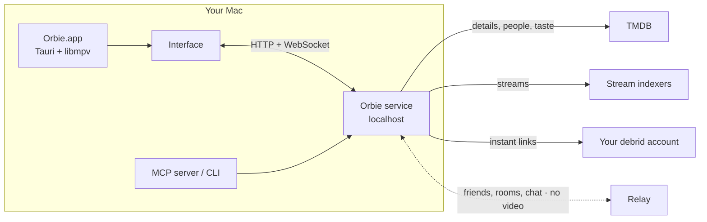

- **The app** is a small Rust shell (Tauri 2). The interface is plain JavaScript in a native web view; video is drawn
  underneath it by libmpv with VideoToolbox hardware decoding.
- **The Orbie service** is one local Node process: catalog, recommendations, search, playback hand-off, social.
- **Nothing is hosted.** Your history, taste and keys live in `~/.config/ironhide` on your Mac.

The full technical tour, settings reference and developer notes are in [docs/TECHNICAL.md](docs/TECHNICAL.md).

</details>

<details>
<summary><b>Status and what's next</b></summary>
<br>

Orbie is being built in the open between friends. Recently landed: the Orbie name and orb, a real-time intro, 120 Hz
interface, instant track switching, Discord presence, collections by country and a frame-rate meter.

On the way: smoother playback on very large 4K remuxes (parallel downloads), more shelves, and a few rough edges in
the settings.

</details>

<br>

## Notes

- Orbie is a player and a lookup tool. It doesn't host or index any content. You are responsible for what you stream
  and for following the terms of the services you connect and the laws where you live.
- Keep invites to people you trust. Each person should use their own accounts.

<div align="center"><br><br><sub>Made with care on a Mac.</sub></div>
