<div align="center">

# IronHide

### Your own streaming hub, with friends in the room.

Browse, search and play from one calm web app that runs on your Mac.<br>
Then invite friends and watch together, perfectly in sync, with chat and live reactions.

<br>

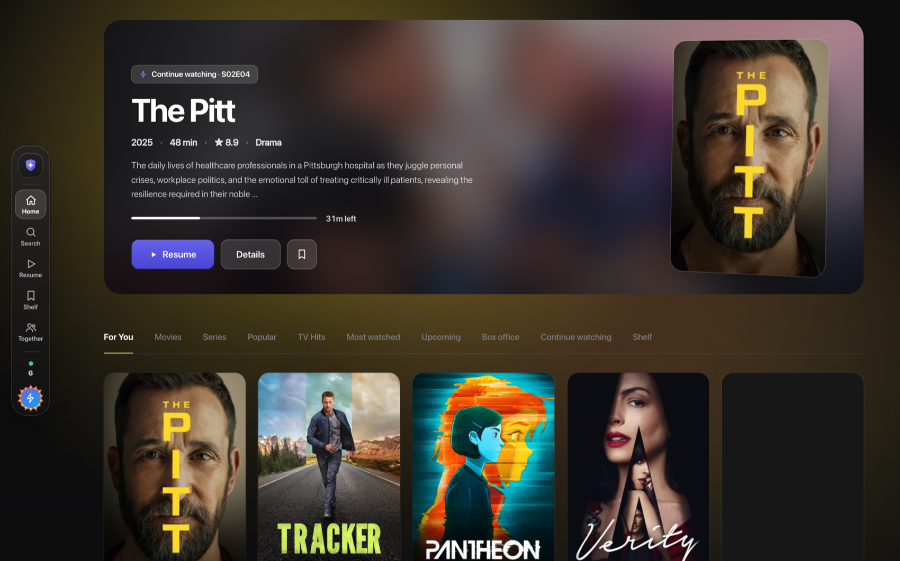

</div>

<br>

## What you get

<table>
<tr>
<td width="33%" valign="top">

**Browse**<br>
Shelves built from your own Trakt harvester. Ambient color follows whatever you hover. Search from anywhere with <kbd>/</kbd>.

</td>
<td width="33%" valign="top">

**Play**<br>
mpv for every codec in full screen, or an in-browser player with GPU transcode, subtitles, audio tracks and scrub previews.

</td>
<td width="33%" valign="top">

**Watch together**<br>
Friends, rooms, a shared countdown, drift-corrected sync, chat and floating reactions.

</td>
</tr>
</table>

Everything runs **on your machine**. Your keys, history and settings never leave it. The only optional hosted piece is a tiny relay that passes friend, room and chat messages. **No video ever goes through it.**

<br>

## The tour

### Pick a version, not a torrent
A centered popup per title: poster, synopsis, cast, trailer, and every version sorted by quality. One **Recommended** card is chosen from your preferences. Tap outside or press <kbd>Esc</kbd> to close.

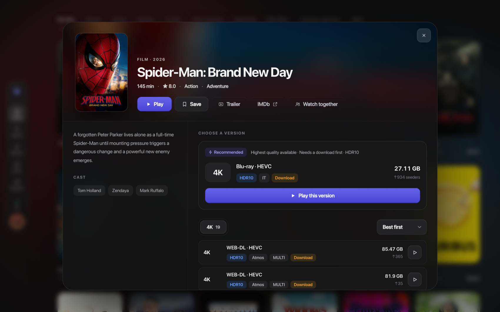

### Search that stays out of the way
<kbd>/</kbd> or <kbd>⌘K</kbd> opens a poster strip of results with commands (themes, pages) underneath.

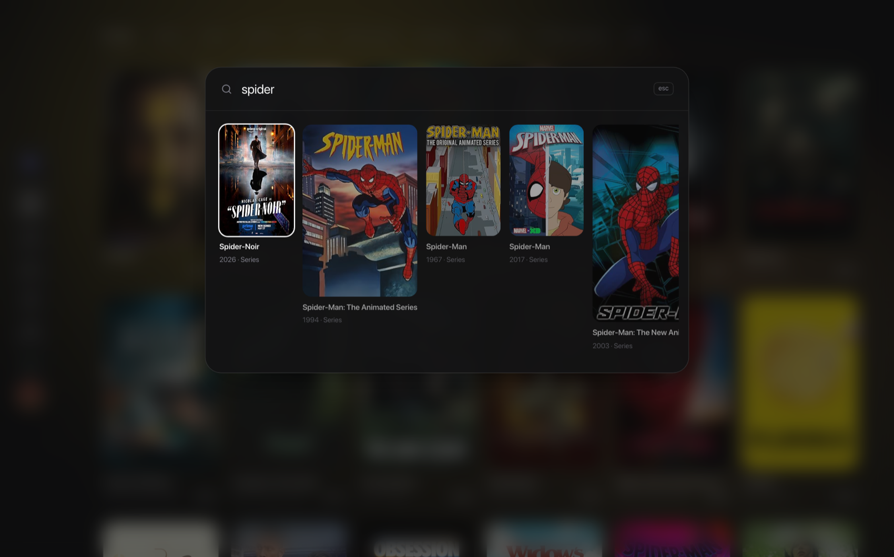

### Together
A room has a code, a host, and a lobby that shows who has finished loading (green dot). Chat and reactions sit next to the title everyone picked. **People here** lists anyone online on your relay, so adding a friend is one click.

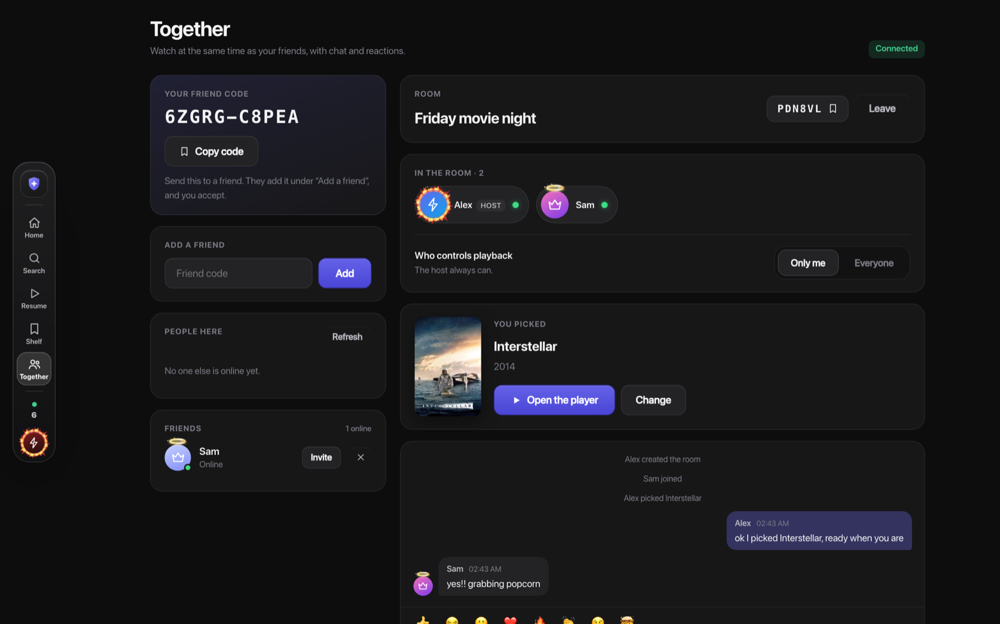

<br>

## Avatars that look like you

Upload a photo, or build one. Every avatar gets an animated **decoration** that sits outside the circle, like Discord's: embers rise off **Inferno**, petals fall around **Sakura**, comets orbit **Galaxy**, lightning crackles around **Storm**. All 16 are recolorable. Pick a **Look** for a matched gradient and decoration in one click.

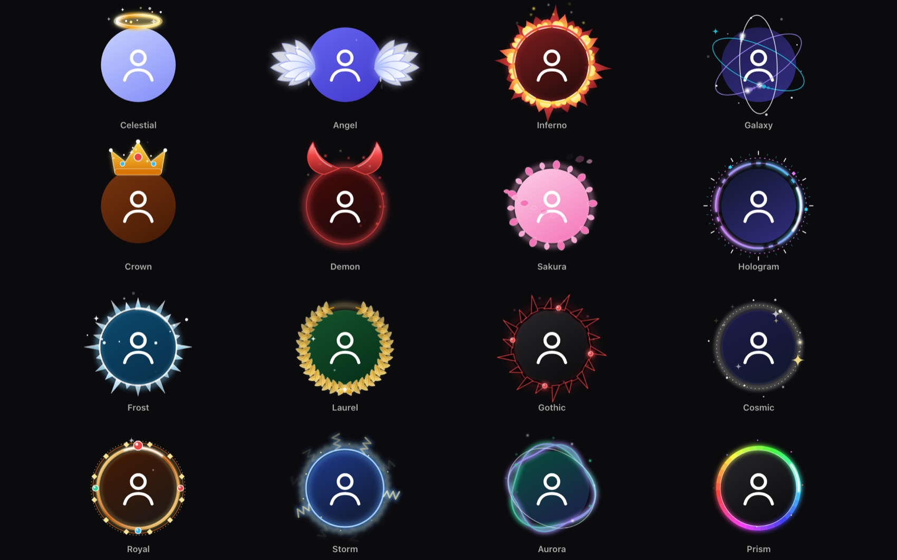

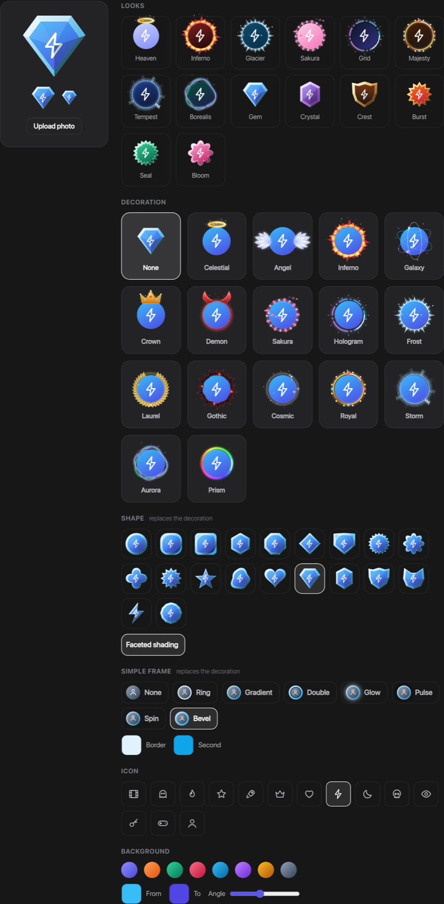

### Real shapes, lit like cut gems

Prefer a shaped face over a decoration? There are **20 silhouettes**: hexagon, octagon, diamond, shield, seal, flower, clover, starburst, star, blob, heart, gem, crystal, crest, cat, bolt, badge and more. They are true polygons, not rounded rectangles. The **Bevel** frame draws every edge as its own lit facet (light from the top left), and **Faceted shading** adds low-poly triangles across the face.

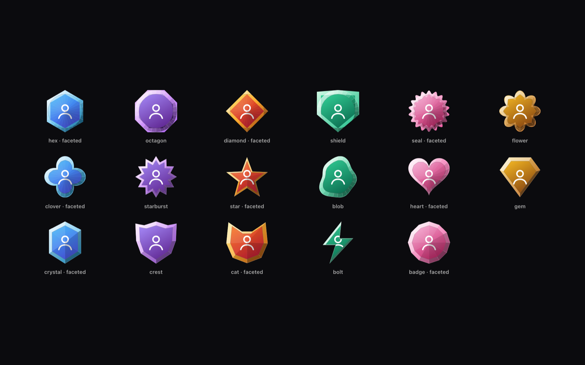

<sub>Decorations always sit on a circle so they fit. Pick a shape or frame and the decoration steps aside.</sub>

<br>

## Settings that just save

No "Save" buttons. Change something and it is stored.

<table>
<tr>
<td width="50%">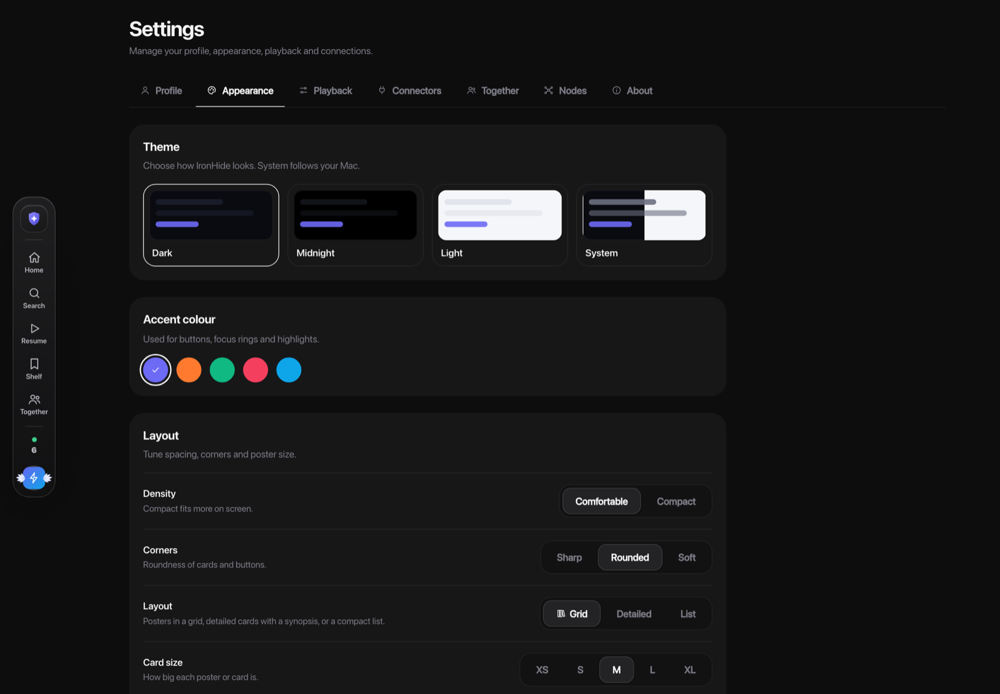<br><sub><b>Appearance</b> · theme, accent, density, corner radius, motion, card size XS to XL, grid / detail / list, hero on or off</sub></td>
<td width="50%">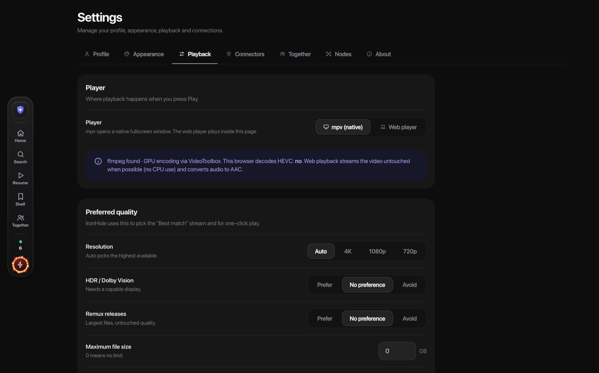<br><sub><b>Playback</b> · mpv or browser player, preferred quality, HDR, remux, size cap, cached only</sub></td>
</tr>
<tr>
<td width="50%">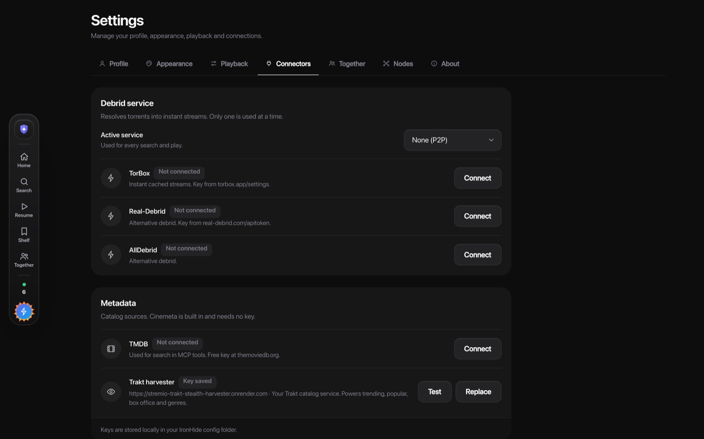<br><sub><b>Connectors</b> · TorBox, Real-Debrid, AllDebrid, TMDB, your harvester</sub></td>
<td width="50%">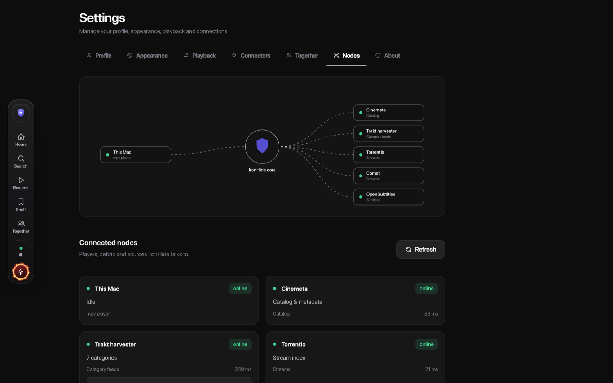<br><sub><b>Nodes</b> · a live graph of everything IronHide talks to, with latency</sub></td>
</tr>
<tr>
<td width="50%">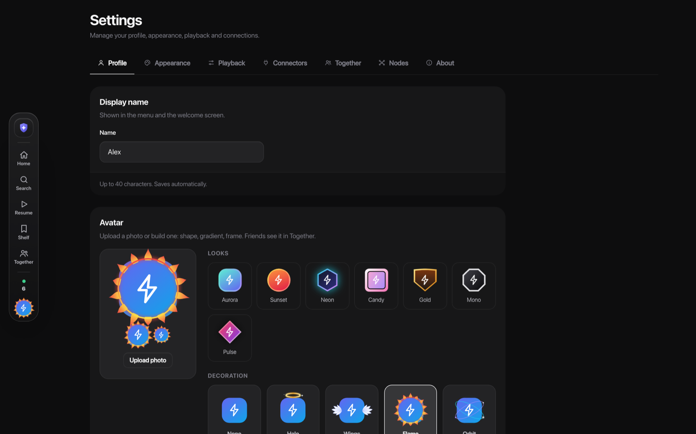<br><sub><b>Profile</b> · name and the avatar studio</sub></td>
<td width="50%">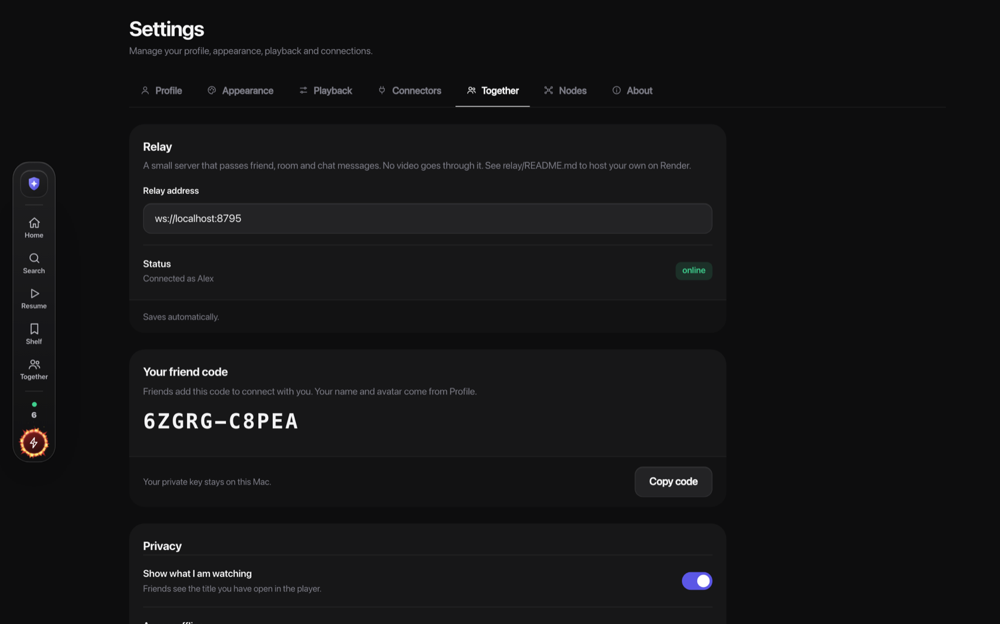<br><sub><b>Together</b> · relay address, friend code, privacy toggles</sub></td>
</tr>
</table>

### On your phone

The rail becomes a bottom bar, shelves stack and scroll.

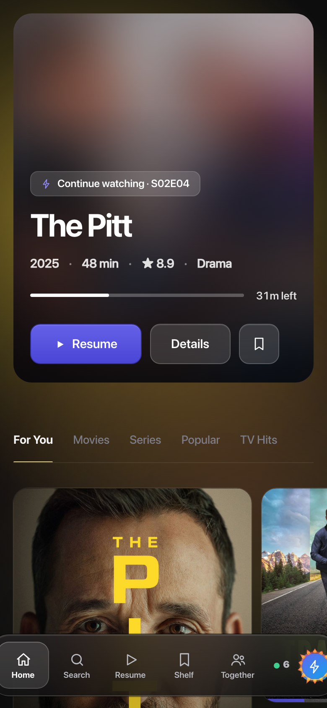 &nbsp;&nbsp; 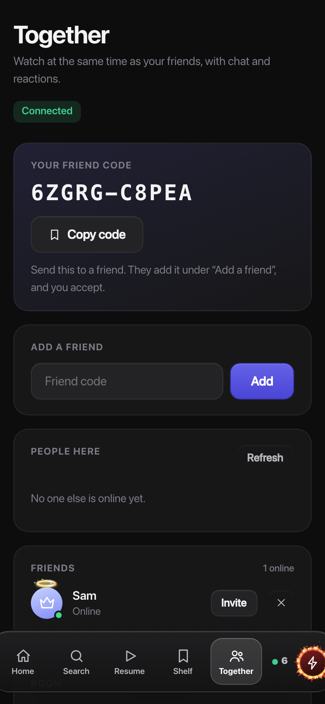

<br>

## Features

**Discover**
- Shelves: For You, Movies, Series, Popular, TV Hits, Most watched, Upcoming, Box office, Continue watching, Shelf
- Genre filters, instant search, built-in trailer player
- Resume from the exact second, a watch list, history carried over from the CLI

**Choose**
- Streams from Torrentio and Comet, flagged *cached* (instant) or *needs a download*
- Badges for Dolby Vision, HDR10, Atmos, MULTI, Remux, HEVC
- Group by 4K / 1080p / other, sort by best, size or seeders
- Preferences for quality, HDR, remux, max size

**Play**
- **mpv**: launch indicator, hidden-then-fullscreen hand-off, now-playing screen, remote control (pause, seek, volume, audio and subtitle tracks, speed)
- **Browser player**: ffprobe plan, direct play or GPU transcode, VTT subtitles, audio switching, speed, PiP, fullscreen, scrub previews (instant nearest frame, exact frame when you rest)

**Together**
- Friends by code, or by name from **People here**; rooms with a 6-letter code and invites
- Host-only or everyone-controls playback
- Everyone reports when their copy is buffered, then starts on a shared server clock with a countdown
- Drift is eased out with small rate nudges, large drift is re-seeked
- Chat and reactions in the lobby and in the player drawer
- Presence only between mutual friends; *Appear offline* and *Hide what I'm watching*
- Ed25519 identity created on your Mac; your friend code comes from the public key

**Make it yours**
- Themes: Dark, Midnight, Light, System. Accents, density, radius, motion
- Avatars: photo upload, 16 animated decorations, 20 polygon shapes, a faceted bevel frame, low-poly shading, gradients, one-click Looks
- First-run name screen

**Talk to it**
- An MCP server and a CLI, so Claude can drive it: "play Inception", "resume where I left off", "what's playing?"

<br>

## How it fits together

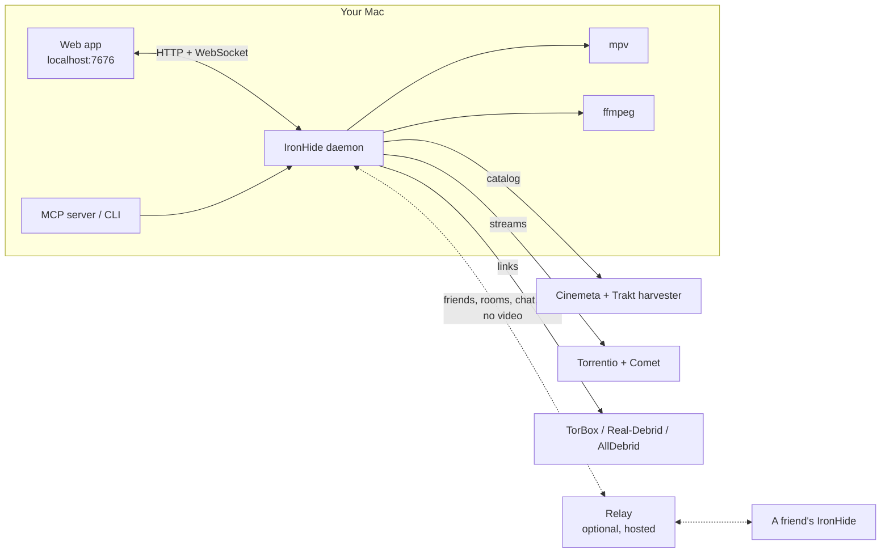

- **One daemon** (`src/daemon.js`) owns the web UI, the API, the player and the social connection.
- **The web app is plain ES modules**, no bundler. Edit a file, refresh.
- **The relay** (`relay/`) is one small WebSocket server, all in memory. It checks signatures, forwards small JSON messages, and never touches media.

<br>

## Quick start

You need macOS, Node 20+, [mpv](https://mpv.io), ffmpeg and a debrid account (TorBox recommended).

```bash
git clone <this repo> && cd ironhide
npm install
./setup.sh        # installs mpv + MoltenVK, writes a good mpv.conf
npm start         # http://localhost:7676
```

Open the app, pick a name, then add your key in **Settings → Connectors**.

### Watch with friends

1. **Deploy the relay.** Render → *New → Blueprint* → this repo. It creates `ironhide-relay` on the free plan with the People list on.
2. Copy its URL, change `https://` to `wss://`, and paste it on the **Together** page. Or set it once in `src/relay-default.js` so everyone who pulls the repo connects automatically.
3. Each friend runs IronHide on their own Mac with their **own** debrid key, and you find each other under **People here**.

Try it with no hosting: `RELAY_DIRECTORY=1 PORT=8790 node relay/server.js`, then start two IronHides pointed at `ws://localhost:8790` (the second with `IRONHIDE_HOME=/tmp/ih2 IRONHIDE_PORT=7677`).

### Configuration

| Variable | What it does |
|---|---|
| `IRONHIDE_PORT` | Daemon port (default `7676`) |
| `IRONHIDE_HOME` | Config and data folder (default `~/.config/ironhide`), one per instance |
| `IRONHIDE_RELAY` | Default relay address when none is set |
| `IRONHIDE_NO_BRIDGE` | Skip the optional TV bridge |
| `RELAY_DIRECTORY=1` | Relay: enable People here and unique online names |
| `PORT` | Relay port (default `8790`) |

Keys live in `~/.config/ironhide/config.json` and only go to the service they belong to. Keys are stripped from API errors before they reach the browser.

<br>

## Project layout

```
src/            daemon, API, catalog, stream lookup, player, web player, social client
web/            the web app: pages, player, Together, avatar studio and decorations, CSS
relay/          the optional friends / rooms relay (deploys on its own)
mcp/            MCP server (a thin client for the daemon)
bin/            the ironhide CLI
hub/            experimental multi-user host
docs/screens/   the screenshots above
```

<br>

## Status

**Checked in a browser:** browsing, search, title popup, settings, avatar studio and all 16 decorations, friends, rooms, chat and reactions between two instances.

**Still to prove end to end:** synced playback across two real players, the browser player's HEVC / 4K / transcode paths, and the mobile layout on a real phone.

`hub/` is an experiment for hosting many users on one server. Playing straight from a debrid CDN in a browser fails for most releases (DTS and similar audio), so the supported setup is *everyone runs their own IronHide, one shared relay*.

<br>

## Notes

- IronHide is a player and a lookup tool. It does not host or index content. You are responsible for what you stream and for following the terms of the services you connect and the laws where you live.
- Each person should use **their own** debrid account. Sharing one between people breaks most providers' terms.

<div align="center"><br><sub>Plain JavaScript, a lot of CSS, no build step.</sub></div>
